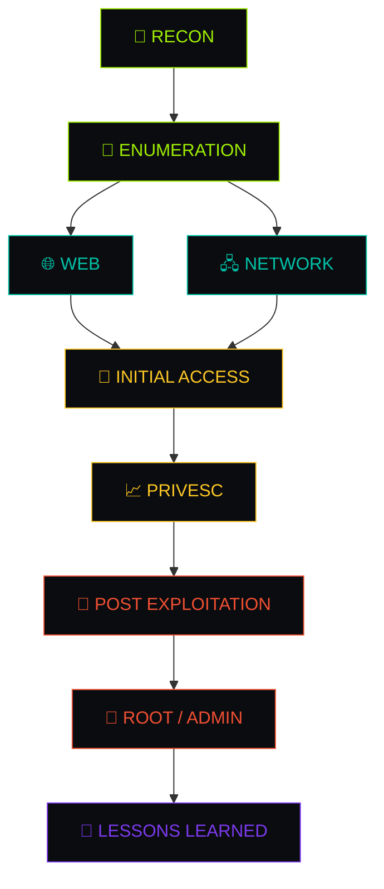

<div align="center">


<br>

[](https://git.io/typing-svg)

<br>


</div>

<br>

## 👋 Sobre mí

Soy **Javier Rioseco Rodríguez**, tengo 21 años y soy estudiante apasionado por la **ciberseguridad ofensiva** (pentesting, red team, CTFs). Este repositorio es mi laboratorio público: donde documento cada máquina, cada CVE que exploto, cada técnica que aprendo y cada error que cometo por el camino.

No busco solo coleccionar writeups. Busco construir una **base de conocimiento conectada**, al estilo *second brain*, donde una técnica de post-explotación en Kubernetes se enlaza con la nota de RBAC, que se enlaza con el cheatsheet de `kubectl`, que se enlaza con la máquina donde la usé por primera vez.

```txt
> whoami
Javier Rioseco Rodríguez — 21 años — Estudiante de ciberseguridad
> objetivo
Construir un porfolio técnico real, verificable y útil — no solo "resolví la máquina"
> stack mental
Ofensiva web · Linux/Windows privesc · Active Directory · Cloud & Kubernetes
```

> [!TIP]
> Si eres reclutador o parte de un equipo de seguridad: cada nota de este repo está pensada para demostrar **proceso de pensamiento**, no solo el resultado final. Empieza por [`06 - Writeups/`](./06%20-%20Writeups) para ver ejemplos completos.

<br>

## 🧭 Mapa de conocimiento



<br>

## 📂 Estructura del repositorio

| Carpeta | Contenido |
|---|---|
| 📊 `00 - Dashboard/` | Panel principal de Obsidian: progreso, enlaces rápidos, vista general |
| 🖥️ `01 - Machines/` | Notas personales de máquinas (HTB, VulnHub, etc.) |
| 🧩 `02 - Challenges/` | Retos individuales (web, pwn, crypto, forense...) |
| 🎓 `03 - Academy/` | Apuntes de HTB Academy y otras formaciones |
| 🧠 `04 - Notes/` | Conceptos de seguridad, teoría y fundamentos |
| ⚡ `05 - Cheatsheets/` | Referencias rápidas de comandos y herramientas |
| 📖 `06 - Writeups/` | Writeups seleccionados, pulidos y listos para compartir |
| 🧱 `99 - Templates/` | Plantillas de Obsidian para nuevas notas |
| 🖼️ `Attachments/` | Imágenes y material de apoyo |

<br>

## 🧠 Áreas de estudio

<table>
<tr>
<td valign="top" width="50%">

### 🔎 Reconocimiento
- Nmap avanzado
- Enumeración DNS
- Descubrimiento de servicios
- OSINT
- Mapeo de superficie de ataque

### 🌐 Web Security
- HTTP / Burp Suite
- Enumeración de directorios
- Autenticación y JWT
- SQL Injection · XSS
- LFI/RFI · Command Injection

### 🐧 Linux
- Enumeración de privilegios
- SUID / SGID · sudo · cron
- Capabilities
- Kernel exploits
- Shells & tratamiento de TTY

</td>
<td valign="top" width="50%">

### 🪟 Windows
- PowerShell ofensivo
- SMB / WinRM
- Enumeración de usuarios y servicios
- Token privileges
- Abuso de servicios

### 🏢 Active Directory
- Kerberos (AS-REP, Kerberoasting)
- LDAP · BloodHound
- NTLM relay
- Delegación (constrained/unconstrained)
- Abuso de ACLs · movimiento lateral

### ☁️ Cloud & Contenedores
- Docker / Kubernetes
- Abuso de RBAC
- Pivoting entre pods y nodos
- Explotación de APIs internas (MCP, microservicios)

</td>
</tr>
</table>

<br>

## 🛠️ Stack de herramientas

<div align="center">


</div>

<div align="center">

`Nmap` · `Burp Suite` · `ffuf` · `Gobuster` · `Feroxbuster` · `Impacket` · `BloodHound` · `NetExec` · `CrackMapExec` · `Hashcat` · `John the Ripper` · `Metasploit` · `LinPEAS` · `WinPEAS` · `Chisel` · `Ligolo-ng`

</div>

<br>

## 📊 Progreso

```
Machines       ███████░░░  70%  In progress
Challenges     ████░░░░░░  40%  In progress
Academy        █████░░░░░  50%  In progress
Knowledge Base ██████░░░░  60%  Growing steadily
```

<br>

## 🧪 Metodología

Cada nota sigue el mismo ciclo, para que el conocimiento sea siempre reutilizable:

```
Recon → Enumeration → Attack Surface → Initial Access
  → Shell → Privilege Escalation → Post Exploitation → Lessons Learned
```

No me limito a registrar **qué funcionó**. Cada nota intenta responder también:

- 🤔 **Por qué** funcionó ese vector concreto
- ❌ **Por qué fallaron** otros enfoques que probé antes
- 🔍 Qué **indicadores** apuntaban a la vulnerabilidad
- 🛠️ Qué herramientas resultaron realmente útiles
- 🚀 Qué haría **diferente** la próxima vez

<br>

## 🚀 Cómo navegar este repo

1. Si quieres ver el **nivel de detalle técnico**, entra en [`06 - Writeups/`](./06%20-%20Writeups) — son las notas más pulidas.
2. Si te interesa cómo organizo el conocimiento, abre este repo en **Obsidian** y explora el grafo de enlaces (`Graph View`) desde `00 - Dashboard/`.
3. Si buscas referencias rápidas de comandos, mira `05 - Cheatsheets/`.

> [!NOTE]
> Este repositorio está pensado para leerse tanto en GitHub como en Obsidian. Los enlaces internos (`[[nota]]`) funcionan en Obsidian; en GitHub se muestran como texto plano.

<br>

## ⚠️ Disclaimer

Este repositorio tiene fines **educativos** y de práctica en entornos **autorizados** (Hack The Box, VulnHub, laboratorios propios, CTFs).

Las técnicas aquí documentadas deben usarse **únicamente** contra sistemas y entornos para los que tengas autorización explícita. No me hago responsable del mal uso de la información aquí contenida.

<br>

## 📬 Contacto

<div align="center">

<a href="https://www.hackthebox.com/"></a>
<a href="#"></a>
<a href="#"></a>

</div>

<br>

<div align="center">

### 🚧 Work in progress

Esta base de conocimiento crece continuamente a medida que resuelvo nuevas máquinas, retos y técnicas.


</div>
